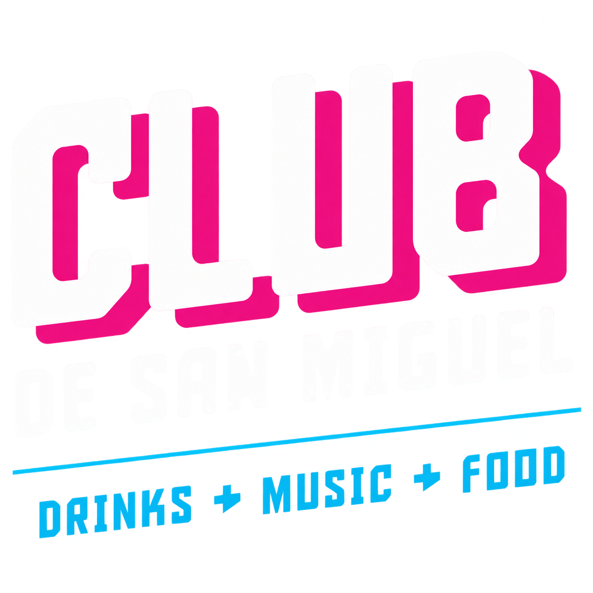
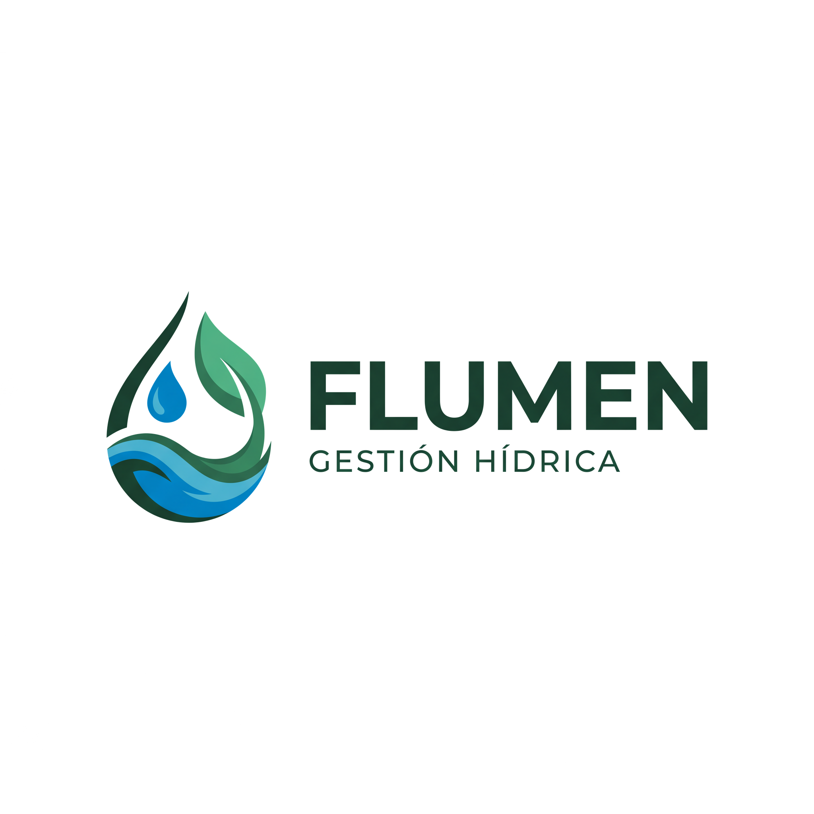

# Hola, soy Lucas Henríquez 👋
### Ingeniero en Informática | Full-Stack Developer, APIs & Automatización Operativa

Mi camino en el desarrollo de software comenzó en **2022 en INACAP**, en la **sede de Renca**, donde construí las bases de mi formación en Ingeniería en Informática. Lo que partió explorando lógica de programación, modelamiento de bases de datos y redes, evolucionó rápidamente hacia el diseño y despliegue de sistemas reales en producción en la comuna de **San Miguel**.

Hoy me especializo en el desarrollo **Full-Stack**, la integración de APIs complejas y la automatización de procesos operativos en el área de restaurantes. Me enfoco en transformar requerimientos de negocio en plataformas estables, escalables y orientadas a resultados, combinando buenas prácticas de ingeniería de software y gestión de servicios TI.

---

### 📈 Mi Trayectoria

- **2022 — INACAP Sede Renca:** Inicio de la carrera de Ingeniería en Informática. Construcción de bases sólidas en lógica de programación, modelamiento de bases de datos, arquitectura y redes.
- **Evolución hacia Producción en San Miguel:** Paso de ejercicios académicos a sistemas operativos reales desplegados en la comuna de San Miguel, resolviendo necesidades concretas de operación, control y automatización.
- **Especialización Actual:** Desarrollo Full-Stack, integración de APIs externas, facturación y mensajería, control de inventarios y flujos automatizados para el rubro gastronómico y de locales, junto con el desarrollo de mi proyecto de titulación (**Flumen**).

---

### 🛠️ Stack Tecnológico

**Backend & Bases de Datos:**

**Frontend:**

**Cloud, Infraestructura & Prácticas:**

---

### 🚀 Proyectos Destacados

#### **Club de San Miguel — Ecosistema Operativo, ERP, POS & Automatización**
- *Stack:* Node.js, Express, MongoDB, Railway, Cloudflare R2, WhatsApp Business API, Twilio, Bsale, SMTP / Telegram.
- **Evolución y fases trabajadas:**
  - **Operación, reservas y atención:** Gestión de reservas, calendarios de eventos, mensajería automatizada y notificaciones por WhatsApp, Twilio, correo y Telegram.
  - **Carta digital y experiencia del local:** Carta digital con filtros, maridajes y paneles administrativos para gestión en tiempo real.
  - **Control de inventario y operación interna:** Módulos de inventario para bodega y barra, control de cocina (KDS), validación de accesos/tickets y respaldos/recuperación en infraestructura web y cloud.
  - **Integraciones y facturación:** Conexión con flujos de venta y facturación electrónica con Bsale, además de soporte técnico y hardware operativo en punto de venta.

---

#### **Flumen — Proyecto de Titulación (Gestión Hídrica y Riego)**
- *Stack:* Angular, Node.js, MongoDB Atlas, Cálculos Hidráulicos (Ecuación de Manning), Mapeo Vectorial.
- Plataforma desarrollada como proyecto de titulación enfocada en la gestión de recursos hídricos y riego agrícola, combinando cálculos hidráulicos automatizados, visualización/mapeo espacial y administración de turnos de agua.

---

### 🧩 Más Sobre Mí

- **Resolución práctica de problemas:** Me gusta meter mano tanto en el código como en la infraestructura, redes, hardware y puesta a punto de sistemas cuando algo falla en terreno.
- **Mentalidad de continuidad:** Priorizo que lo que se construye funcione de forma confiable en el día a día, tenga respaldo y escale sin romperse ante cambios operativos.
- **Fuera del teclado:** Disfruto de la mecánica automotriz y la conducción, el simracing, el diseño/impresión 3D y el airsoft táctico.

---

### 📊 Métricas & Actividad

  
  

---

### 📬 Contacto & Enlaces

